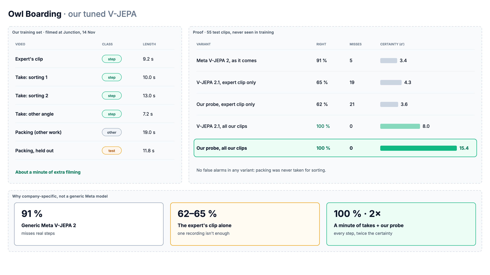

# Owl Boarding 🦉

**Onboarding for all physical work, on Meta Ray-Ban Display glasses.** [owlboarding.com](https://owlboarding.com) · Our entry to the Meta challenge "AI Glasses for Everyone, Everyday" at Junction 2026.

White-collar onboarding has a hundred SaaS tools. Physical work has none. In a warehouse, a restaurant, a bakery or on a building site, the knowledge is tacit and onboarding is slow, so companies prefer to hire people who already know the job. Owl lets an expert record a working day once. Every new worker then learns it from their own view, with their hands free, and Owl checks the work as they go.

Owl is a learning aid, not a monitoring tool. The full product spec is [docs/specs/onboarding-owl.md](docs/specs/onboarding-owl.md).

## What it does

| Feature | What happens |
|---|---|
| **Record** | An experienced worker does the task with the glasses on and narrates. Owl turns it into a guided process: steps, reference pictures, short clips and check criteria. |
| **Learn & Check** | A new worker follows the process on the display. **Owl Check** compares what the camera sees with the step and warns about a wrong product or quantity. A step counts as done only when Owl verified it. |
| **Watch how** | The expert's own clip for the step plays on the glasses display. |
| **Ask** | The worker asks out loud and gets an answer from the company's own documents, with the source. |
| **Help** | When stuck, the worker shares their live view. The shift manager answers on their own glasses, or an expert in Owl Studio. They guide by voice and can point at the picture. |
| **Training period** | The company sets the length (for example a week) and the target level. At the end Owl suggests "Ready" or "More practice", the worker sees it first, and a person confirms it. |
| **Location** | During training Owl recognises where the worker is from the camera picture, and the next part opens at the right spot. |
| **Customer service** | During training Owl listens at the counter, and a Hint pinch shows two or three points from the company's handbook. |

Every new worker gets a personal welcome in their own language. Easy-language, audio-first and display-first profiles make Owl usable for immigrants, people in supported employment, people with dyslexia and people with low vision or hearing. The phone stays in the pocket: the Neural Band does the rest, and "Hey Meta, start Owl" opens Owl once the app is registered in Meta's Wearables Developer Center.

## How it fits together


## Apps

| App | What it is |
|---|---|
| [`apps/owl-glasses`](apps/owl-glasses/README.md) | The iPhone app for Meta Ray-Ban Display glasses, built on Meta's Wearables Device Access Toolkit (DAT): display, camera, Neural Band, speech, voice invocations |
| [`apps/owl-api`](apps/owl-api/README.md) | The engine: processes, Owl Check, Ask, Record, Help, training, location and customer service |
| [`apps/owl-studio`](apps/owl-studio/README.md) | The company's web app: documents, recorded tasks, workers, training, the map, the Help console and where the data goes |
| [`apps/owl-lens-site`](apps/owl-lens-site/README.md) | The launch page at owlboarding.com: the glasses in 3D, a flight into the lens and real Display recordings from Junction |
| [`apps/owl-site`](apps/owl-site/README.md) | The earlier launch site, kept in the repo |

**AI engine (what runs in the demo, no Anthropic key needed):**

| Job | Model |
|---|---|
| Owl Check sees the step in one camera picture | NVIDIA **Nemotron 3.5 Super VL**, open weights, on a **Verda** GPU in Finland (`LLM_BACKEND=nemotron`) |
| Record, Ask, the customer-service Hint, translations, tasks from documents | the same Nemotron. Answers pass only with a quote found word for word in the company's documents |
| Which step the worker is doing, from 2 s of video | Meta's **V-JEPA 2.1** (March 2026), frozen, with Meta's **attentive probe** trained per task on the expert's own clips (`JEPA_BACKEND=vjepa21`). On the demo's own videos, which are in the repo: 55 of 55 held-out windows, and twice the margin of the same model untrained (d′ 15.4 vs 8.0; Meta's V-JEPA 2 as it comes: 91 %, d′ 3.4) ([data card](apps/owl-api/fixtures/stories/junction/jepa/README.md)) |
| Where the worker is (unlocks the next part) | Meta's **DINOv2** |
| Right, wrong or done | deterministic rules: two looks in a row before a warning or Owl's own ✓ |

**Why a V-JEPA tuned to the company's own task, not a generic model.** The same 55 test windows, none of them seen in training. Meta's V-JEPA 2 as it comes gets 91 %; the expert's clip alone gets 62–65 %; a minute of extra takes and our probe get 100 % with twice the margin of the same model untrained. The videos, the script and the limits are in the [data card](apps/owl-api/fixtures/stories/junction/jepa/README.md).



**Owl learns from use.** Every step Owl Check passes or warns on can become one more V-JEPA example of that step: an embedding, never video, not tied to the worker, at most 20 per step. The task's probe then retrains itself in the background, in seconds on the Verda GPU. So the more a task is done, the better the local model knows it, without anyone labelling anything. It is built and tested (`tests/test_jepa.py`) and switched on with one setting, `JEPA_LEARN_FROM_USE=1`. It is off in the Junction demo.

Claude (`LLM_BACKEND=claude`) and Jev (TypeSafe) still work when their keys are set. `GET /health` says which models really run.

## Run it

**The demo video, on your machine.** Everything it ran on is in this repo: the Junction story (people, task, handbook), the expert's clip, the place photos and the V-JEPA training videos. You bring a model key: an OpenAI-compatible Nemotron 3.5 Super VL endpoint (ours ran on Verda and is closed after the event) or an Anthropic key. Step by step, including the glasses, the tunnel and what each scene should do: **[docs/runbooks/owl-junction-demo.md](docs/runbooks/owl-junction-demo.md)**.

```sh
# owl-api (Python 3.13+, uv). Put VERDA_INFERENCE_KEY (+ NEMOTRON_URL) or ANTHROPIC_API_KEY in .env yourself.
cd apps/owl-api && cp .env.example .env
OWL_RESET=1 OWL_STORY=junction DATA_DIR=data/junction OWL_STAGE=1 \
  LLM_BACKEND=nemotron JEPA_BACKEND=vjepa21 PUBLIC_BASE_URL=https://<tunnel> \
  uv run --extra jepa --env-file .env uvicorn app.main:app --host 0.0.0.0 --port 8000

# Owl Studio (Node 22.12+), in another terminal
cd apps/owl-studio && npm ci && VITE_API_URL=https://<tunnel> npm run dev

# V-JEPA 2.1 on the demo's own videos (leave one video out)
cd apps/owl-api && uv run --extra jepa python scripts/jepa_probe_eval.py
```

**Without any key.** Demo mode plays the pick-and-pack story by itself: a wrong 0.5 l carton is caught, then the fixed box passes. It is scripted, and every check says `decided_by: "demo"`.

```sh
cd apps/owl-api && OWL_DEMO=1 uv run uvicorn app.main:app --host 0.0.0.0 --port 8000
cd apps/owl-studio && npm ci && npm run dev
```

**The glasses app** runs on Meta Ray-Ban Display glasses or in the iOS Simulator with Meta's MockDeviceKit: [apps/owl-glasses/README.md](apps/owl-glasses/README.md). On real glasses the iPhone reaches owl-api through an https tunnel.

## Data and consent

The worker agrees on the glasses before the camera checks anything, and can pause the camera at any time. Check pictures are not stored. Faces in recorded clips are blurred. Help views are deleted when the call ends. The worker's progress belongs to the worker, and **Forget me** erases it. What goes where, including what goes to the model provider, is listed in the spec under [Where the data goes](docs/specs/onboarding-owl.md#where-the-data-goes) and in Owl Studio's Data view.

## What existed before the event

Junction rules allow no code written before the event. Before hacking started (Fri 13.11 19:30) this repo held only generic, idea-agnostic tooling: agent instructions, Claude Code skills, CI workflows, doc templates and the tech-stack ADR. There was no product code, spec or idea-specific content. Everything under `apps/`, `docs/specs/` and `design/JUN-<n>/` was written at the event. The one exception is open-source code: `apps/owl-glasses` started from Meta's open-source DAT `DisplayAccess` sample (licence in `apps/owl-glasses/LICENSE-meta-sample`).

On the first night we also tried a money coach for the S-Bank challenge and a calorie tracker for camera glasses. They are not part of this submission. Their code was removed and is only in git history.

## How we work

AI agents do most of the work from Linear tickets (team `JUN`).

- **Agents:** start with [AGENTS.md](AGENTS.md).
- **Humans:** start with [docs/runbooks/agent-onboarding.md](docs/runbooks/agent-onboarding.md) and [docs/runbooks/local-dev.md](docs/runbooks/local-dev.md).
- **Doc index:** [docs/MAP.md](docs/MAP.md).

**Stack:** Swift and Meta DAT for the glasses app, Python with FastAPI for the API, Vite, React and TypeScript for the web apps. See [ADR-001](docs/architecture/adr-001-tech-stack.md) and [ADR-003](docs/architecture/adr-003-glasses-app-dat-ios.md).

## Team

**Bossit**, at Junction 2026:

| Name | GitHub |
|---|---|
| Aapo Putkonen | [@ApsiApina71](https://github.com/ApsiApina71) |
| Lauri Pörsti | [@LauriPor](https://github.com/LauriPor) |
| Antti Nieminen | [@ajknieminen-cpu](https://github.com/ajknieminen-cpu) |
| Johannes Tenhunen | [@BuliFit](https://github.com/BuliFit) |

## License

[MIT](LICENSE). Junction licenses every project submission under MIT.
